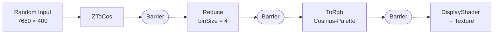

<div class="absolute inset-0 bg-black bg-opacity-65"></div>

<div class="relative">

# Shaders

## GPU Compute in reinem C# — ohne eine Zeile HLSL

<div class="pt-8 text-xl opacity-80">
.NET 10 · MAUI · ComputeSharp · DirectX 12
</div>

<div class="pt-12 text-sm opacity-60">
Louis Wehmschulte &middot; Oliver Siegemund &nbsp;|&nbsp; ROSEN NXT
</div>

</div>

<div class="absolute bottom-4 right-6 text-xs opacity-40 z-10">
Hintergrund: Live-Ausgabe der Pipeline
</div>

<!--
Ein Ein-Tages-Tech-Spike: 19 Commits, zwei Entwickler, ein Ziel —
herausfinden, wie weit man mit GPU-Compute aus C# heraus kommt.
-->

---
layout: center
class: text-center
---

# Das Ergebnis vorweg

<div class="grid grid-cols-3 gap-8 pt-8">
  <div>
    <div class="text-6xl font-bold text-red-400">39,8<span class="text-2xl">ms</span></div>
    <div class="opacity-70 pt-2">CPU</div>
  </div>
  <div>
    <div class="text-6xl font-bold text-green-400">6,3<span class="text-2xl">ms</span></div>
    <div class="opacity-70 pt-2">GPU</div>
  </div>
  <div>
    <div class="text-6xl font-bold text-blue-400">6,3×</div>
    <div class="opacity-70 pt-2">Speedup</div>
  </div>
</div>

<div class="pt-10 opacity-60 text-sm">
3.072.000 Floats &middot; cos + Reduce &middot; inkl. Upload und Readback
</div>

---

# Das Problem

<v-clicks>

- GPU-Compute bedeutet normalerweise: **HLSL-Dateien**, Shader-Compiler, DX12-Boilerplate
- Zwei Sprachen, zwei Toolchains, keine Typsicherheit über die Grenze hinweg
- Kein Debugging, kein IntelliSense, kein Refactoring
- Integration in eine bestehende .NET-UI? Aufwändig.

</v-clicks>

<v-click>

<div class="pt-8 text-xl">

**Frage des Spikes:** Wie weit kommt man mit **ComputeSharp** — C# rein, HLSL raus, per Source Generator?

</div>

</v-click>

---

# Der Stack

<div class="grid grid-cols-2 gap-8 pt-4">

<div>

### Runtime & UI
- **.NET 10.0** (SDK 10.0.403)
- **.NET MAUI** — Windows-only (`net10.0-windows10.0.22621.0`)
- Unpackaged (`WindowsPackageType=None`)

### GPU
- **ComputeSharp 3.2.0** — C# → HLSL via Roslyn
- **ComputeSharp.WinUI** — `ComputeShaderPanel`
- Backend: **DirectX 12**

</div>

<div>

### Tooling
- `.slnx` — neues XML-Solution-Format
- **BenchmarkDotNet 0.15.8**
- **NUnit 4.3.2**
- `CommunityToolkit.HighPerformance` 8.4.2

### Moderne C#-Features im Einsatz
- `extension`-Member (C# 14)
- `field`-Keyword in Properties
- `System.Threading.Lock`
- Primary Constructors auf `readonly struct`

</div>

</div>

---

# Kein einziges `.hlsl` im Repo

```csharp {all|1-2|4-11|all}
[GeneratedComputeShaderDescriptor]
internal readonly partial struct ToRgb(
    ReadOnlyBuffer<float> input,
    ReadWriteBuffer<float3> output) : IComputeShader
{
    public void Execute()
    {
        float3 phase = new(0f, 0.33f, 0.67f);
        float value = input[ThreadIds.X];
        // Inigo-Quilez-Cosinus-Palette
        output[ThreadIds.X] = 0.5f + 0.5f * Hlsl.Cos(6.2831853f * (value + phase));
    }
}
```

<v-click>

Der **Roslyn Source Generator** erzeugt daraus zur Compile-Zeit HLSL.
→ Typsicherheit, IntelliSense, Refactoring und Unit-Tests auf Shader-Code.

</v-click>

---

# Die GPU-Pipeline



<div class="pt-6">

```csharp
using ComputeContext ctx = device.CreateComputeContext();
ctx.ZToCos(input, cosBuffer);
ctx.Barrier(cosBuffer);
ctx.Reduce(cosBuffer, reduced, binSize: scale);
ctx.Barrier(reduced);
ctx.ToRgb(reduced, rgb);
ctx.Barrier(rgb);
ctx.For(texture.Width, texture.Height, new DisplayShader(rgb, texture));
```

</div>

<div class="pt-2 text-sm opacity-70">
Explizite Barriers erzwingen Read-after-Write-Ordering zwischen abhängigen Stages — alles in <em>einem</em> Context.
</div>

---

# MAUI ↔ WinUI ↔ DX12 — die Brücke

<div class="grid grid-cols-2 gap-6 pt-2">

<div>

### `ComputeShaderViewHandler`
Ein MAUI `ViewHandler<ComputeShaderView, Grid>`, der einen ComputeSharp-`ComputeShaderPanel` in den MAUI-Visual-Tree einhängt.

- `IsDynamicResolutionEnabled = false`
- `IsVerticalSyncEnabled = true`
- `ResolutionScale = 1.0`
- Sauberer Panel-Rebuild bei **GPU-Wechsel zur Laufzeit**


</div>

<div>

### `FrameRequestQueue`
On-Demand-Rendering statt Dauerschleife.

```csharp
lock (_lock)
{
    if (_semaphore.CurrentCount == 0)
        _semaphore.Release();
}
```

`SemaphoreSlim(0, 1)` **koalesziert** mehrfache Requests
→ ein Frame nur, wenn sich wirklich etwas ändert. Spart Strom & GPU-Zeit.

</div>

</div>

---
layout: image-right
image: /images/app-01.png
---

# Die Anwendung

<v-clicks>

- **GPU-Picker** oben — alle DX12-Adapter, Wechsel im laufenden Betrieb
- **Slider** steuert den Box-Blur-Radius und löst per `RequestFrame()` genau einen Frame aus
- Darunter der `ComputeShaderPanel` — Ausgabe der vollständigen Pipeline

</v-clicks>

<v-click>

<div class="pt-6 text-sm opacity-70">
Die Färbung ist kein Zufall: Random-Input → <code>cos</code> → Reduce → Cosinus-Palette.
Da <code>cos</code> gleichverteilter Werte um die Extrema häuft, landet das Ergebnis
im Grün-Orange-Bereich der Palette.
</div>

</v-click>

---
layout: section
---

# Benchmarks

---

# Setup

<div class="grid grid-cols-2 gap-8 text-sm">

<div>

### Workload
```
width = 1920, height = 100, scale = 4
Input : 7680 × 400 = 3.072.000 Floats (~12 MB)
Output: 192.000 Floats
Pipeline: cos → binned Reduce (binSize 4)
```

**CPU:** `Math.Cos` über alle Elemente, Akkumulation in `output[i / scale]`

**GPU:** Alloc → Upload → `ZToCos` → `Reduce` → `ToArray()`-Readback

</div>

<div>

### Hardware
```
Windows 11 24H2 (10.0.26100.9711)
Intel Core i7-13850HX @ 2.10 GHz
  28 logical / 20 physical cores
NVIDIA RTX 4000 Ada Generation Laptop GPU
.NET SDK 10.0.403 / .NET 10.0.14
RyuJIT x86-64-v3, AVX2, VectorSize=256
Power Plan: Höchstleistung
BenchmarkDotNet 0.15.8
```

</div>

</div>

---

# Ergebnis

| Method | Mean | Error | StdDev | N |
|:---|---:|---:|---:|---:|
| **Cpu** | **39,826 ms** | 0,5189 ms | 0,4854 ms | 15 |
| **Gpu** | **6,302 ms** | 0,1255 ms | 0,3149 ms | 74 |

<div class="pt-6">

<div class="flex items-center gap-4 pb-3">
  <div class="w-16 text-right opacity-70">CPU</div>
  <div class="h-8 bg-red-400 rounded" style="width: 72%"></div>
  <div class="font-mono">39,826 ms</div>
</div>

<div class="flex items-center gap-4">
  <div class="w-16 text-right opacity-70">GPU</div>
  <div class="h-8 bg-green-400 rounded" style="width: 11.4%"></div>
  <div class="font-mono">6,302 ms</div>
</div>

</div>

<div class="pt-8 text-center text-2xl">
<strong>6,32× schneller</strong> &nbsp;·&nbsp; <strong>−33,52 ms</strong> pro Durchlauf
</div>

---

# Details & Streuung

<div class="grid grid-cols-2 gap-8 text-sm">

<div>

### CPU
```
Mean      39,826 ms   StdErr  0,125 ms (0,31 %)
Median    39,938 ms   StdDev  0,485 ms
Min       39,003 ms   Max    40,610 ms
Q1        39,362 ms   Q3     40,123 ms
CI 99,9 % [39,307 ms ; 40,345 ms]
Margin    0,519 ms (1,30 %)
Skewness  −0,08       Kurtosis 1,66
```
Histogramm: ein einziger Bucket — sehr stabil.

</div>

<div>

### GPU
```
Mean       6,302 ms   StdErr  0,037 ms (0,58 %)
Median     6,249 ms   StdDev  0,315 ms
Min        5,859 ms   Max     7,160 ms
Q1         6,065 ms   Q3      6,512 ms
CI 99,9 %  [6,177 ms ; 6,428 ms]
Margin     0,126 ms (1,99 %)
Skewness   0,60       Kurtosis 2,53
```
```
[5,760 ; 5,986) @@@@@@@@@@@          11
[5,986 ; 6,182) @@@@@@@@@@@@@@@@@@@@@@@ 23
[6,182 ; 6,422) @@@@@@@@@@@@@@@@@@   18
[6,422 ; 6,688) @@@@@@@@@@@@@        13
[6,688 ; 6,906) @@@@@@@               7
[6,906 ; 7,188) @@                    2
```

</div>

</div>

<div class="pt-3 text-xs opacity-60">
75 Messungen, 74 behalten (1 Ausreißer bei 7,650 ms entfernt). Overhead-Messung: ~3,1 ns/op → vernachlässigbar.
</div>

---

# Ehrlichkeit zu den Zahlen

<v-clicks>

- ⚠️ **Debug-Build.** Der Lauf nutzt `DebugInProcessConfig` + `InProcessEmitToolchain`. BenchmarkDotNet warnt explizit: *„build it in RELEASE"*. Die CPU-Seite ist dadurch benachteiligt — der reale Speedup liegt **unter** 6,3×.

- ⚠️ **Nicht identische Arbeit.** CPU macht Scatter-Akkumulation in `output[i/4]`, GPU einen gewichteten **Mittelwert** (`1/binSize`). Unterschiedliche Arithmetik, unterschiedliche Ergebnisse.

- ⚠️ **GPU-Zeit enthält alles:** `EnumerateDevices()`, 3 Buffer-Allokationen, 12 MB Upload, `ToArray()`-Readback. Buffer werden nicht disposed → Leak pro Iteration. Die reine Kernel-Zeit wäre drastisch niedriger.

- ⚠️ **Nur Debug-Logs.** `DebugInProcessConfig` definiert keine Exporter — die persistierten `results/`-Dateien aus dem Release-Lauf enthalten nur `NA`.

</v-clicks>

<v-click>

<div class="pt-4 text-center opacity-80">
Die Richtung stimmt. Die Größenordnung ist belastbar. Die exakte Zahl ist es nicht.
</div>

</v-click>

---
layout: section
---

# Main Achievements

---

# Was erreicht wurde

<div class="grid grid-cols-2 gap-5 pt-2">

<div v-click class="p-4 border border-gray-600 rounded">
<div class="text-2xl">⚡ 6,3× Speedup</div>
<div class="text-sm opacity-70 pt-1">39,826 ms → 6,302 ms auf 3,07 Mio Floats, inkl. Transfer und Readback. GPU-only: 4,035 ms.</div>
</div>

<div v-click class="p-4 border border-gray-600 rounded">
<div class="text-2xl">🧊 Null Zeilen HLSL</div>
<div class="text-sm opacity-70 pt-1">Alle Shader als C#-Structs. Source Generator erzeugt HLSL zur Compile-Zeit.</div>
</div>

<div v-click class="p-4 border border-gray-600 rounded">
<div class="text-2xl">🌉 MAUI ↔ DX12 Bridge</div>
<div class="text-sm opacity-70 pt-1">Custom ViewHandler bettet ComputeShaderPanel in den MAUI-Tree ein — nicht-triviales Plumbing.</div>
</div>

<div v-click class="p-4 border border-gray-600 rounded">
<div class="text-2xl">🎛️ GPU-Wechsel zur Laufzeit</div>
<div class="text-sm opacity-70 pt-1">Adapter-Enumeration + Picker, sauberer Panel-Rebuild bei Device-Change.</div>
</div>

<div v-click class="p-4 border border-gray-600 rounded">
<div class="text-2xl">🔋 On-Demand-Rendering</div>
<div class="text-sm opacity-70 pt-1">Koaleszierende FrameRequestQueue statt Render-Loop — Frames nur bei echter Änderung.</div>
</div>

<div v-click class="p-4 border border-gray-600 rounded">
<div class="text-2xl">🔗 Mehrstufige Pipeline</div>
<div class="text-sm opacity-70 pt-1">4 Stages mit expliziten Barriers in einem ComputeContext — komponierbar über Extension Methods.</div>
</div>

</div>

---
layout: center
class: text-center
---

# Fazit

<div class="pt-4 text-xl opacity-90 max-w-3xl mx-auto">

GPU-Compute aus C# heraus ist **praktikabel**.
Die Hürde liegt nicht mehr in der Shader-Sprache,
sondern in **Dispatch-Dimensionierung**, **Device-Lifetime** und **Transfer-Kosten**.

</div>

<div class="pt-10 grid grid-cols-4 gap-4 text-sm opacity-80">
  <div><div class="text-3xl font-bold">6,3×</div>Speedup</div>
  <div><div class="text-3xl font-bold">0</div>Zeilen HLSL</div>
  <div><div class="text-3xl font-bold">5</div>Projekte</div>
  <div><div class="text-3xl font-bold">1</div>Tag</div>
</div>

<div class="pt-12 opacity-50 text-sm">
Louis Wehmschulte &middot; Oliver Siegemund &nbsp;|&nbsp; github.com/LWehmschulteAtRosenxt/Shaders
</div>
